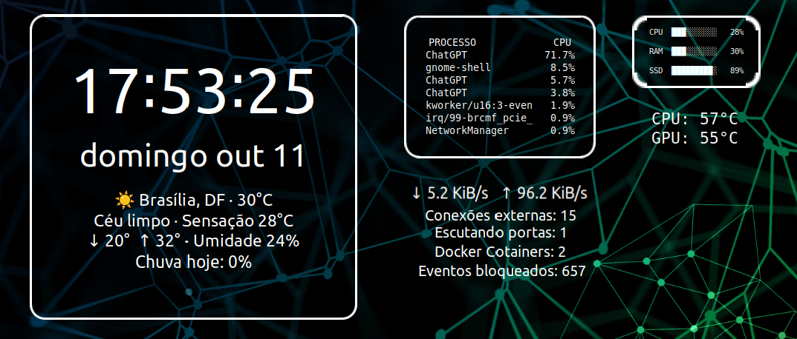
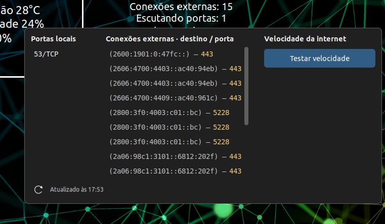
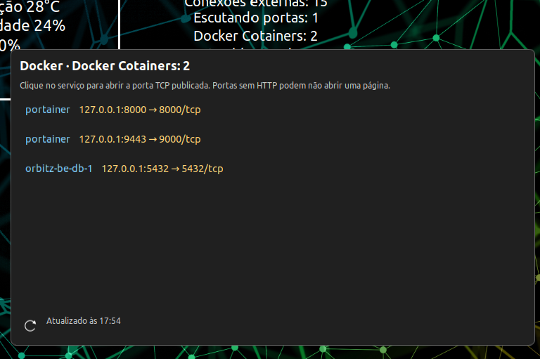
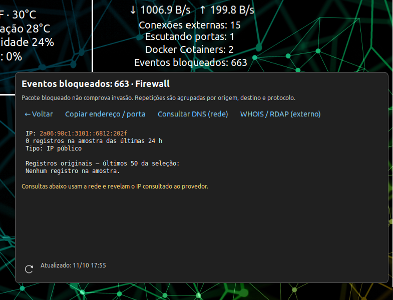

# Orbitz — Widgets for GNOME

**Custom Desktop Clock / azclock widgets for GNOME Shell: Linux system monitoring, network diagnostics, hardware temperatures, storage, weather and Now Playing — powered by Python and GJS.**

**Target platform: Ubuntu 22.04 LTS Desktop (Jammy), with GNOME Shell 42 and Python 3.10.** Ubuntu Server without a GNOME desktop and Ubuntu flavors using KDE/Xfce are not covered. Ubuntu 24.04 and later are not supported by this legacy extension.

Orbitz combines nine standalone Python widget scripts and shared runtime modules with a customized version of [Desktop Clock (azclock)](https://gitlab.com/AndrewZaech/azclock). Display system information directly on your GNOME desktop and open a network panel to inspect TCP connections, listening ports or run an optional internet speed test.

**Looking for azclock / Desktop Clock custom commands?** This project contains a customized copy of Andrew Zaech's **azclock v7** extension and ready-to-use Python command widgets for **Ubuntu 22.04 / GNOME 42**. It keeps the original `azclock@azclock.gitlab.com` UUID and is a community customization, not an official upstream release. See [installation](#download-and-install), [widget commands](#configure-each-widget) and [upstream azclock](https://gitlab.com/AndrewZaech/azclock).

[Download ZIP](https://github.com/orbitzone/orbitz-widgets-for-gnome/archive/refs/heads/main.zip) · [Report an issue](https://github.com/orbitzone/orbitz-widgets-for-gnome/issues) · [Source code](https://github.com/orbitzone/orbitz-widgets-for-gnome)

## Table of contents

- [Screenshots](#screenshots)
- [Desktop overview](#desktop-overview)
- [Security panel](#security-panel)
- [Docker panel](#docker-panel)
- [Firewall inspection](#firewall-inspection)
- [Now Playing](#now-playing)
- [Widgets](#widgets)
- [Stack and compatibility](#stack-and-compatibility)
- [Ubuntu 22.04: install dependencies first](#ubuntu-2204-install-dependencies-first)
- [Required packages](#required-packages)
- [Optional packages](#optional-packages)
- [Download and install](#download-and-install)
- [Configure each widget](#configure-each-widget)
- [Change the weather location](#change-the-weather-location)
- [Enable optional speed testing](#enable-optional-speed-testing)
- [Optional Now Playing widget: Spotify and Chrome/Chromium](#optional-now-playing-widget-spotify-and-chromechromium)
- [Per-widget requirements checklist](#per-widget-requirements-checklist)
- [Docker widget](#docker-widget)
- [Firewall event widget](#firewall-event-widget)
- [Reliability, security and performance](#reliability-security-and-performance)
- [Troubleshooting](#troubleshooting)
- [Contributing](#contributing)
- [Credits and licenses](#credits-and-licenses)

## Screenshots

Screenshots from the configured desktop on October 11, 2026. Layout, fonts and positions are configurable.

### Desktop overview

Clock/weather, processes, CPU/RAM/storage, temperatures and separate traffic, security, Docker and firewall widgets.



### Security panel

Local TCP listeners, remote destinations and the optional speed test. Opening the panel or clicking refresh collects a new snapshot.



### Docker panel

Running containers and published host ports. Recognized web services open in the browser; other ports remain visible without an automatic web link.



### Firewall inspection

Inspect a selected IP or port, copy it, request reverse DNS or open public-IP RDAP information.



### Now Playing

Playback status, artist and title, followed by a small Spotify or Chrome icon identifying the selected player.


## Widgets

| Widget / script | What it does |
|---|---|
| **CPU, RAM and storage** — `cpu-ram-widget.py` | Shows CPU utilization, RAM usage and storage usage for the filesystem containing your home directory, with text progress bars. |
| **Top processes** — `processos-widget.py` | Lists up to seven processes ranked by CPU consumption over a one-second sample. Process usage may exceed 100% on multicore systems. |
| **Network traffic** — `rede-widget.py` | Shows current receive/transmit rates for the interface selected from the default route (IPv4, with IPv6 fallback). This measures traffic, not your connection's maximum speed. |
| **TCP connections and ports** — `seguranca-widget.py` | Counts non-loopback TCP connections and listening ports. Click the widget to open a panel with local ports and remote destinations; click a hostname to copy its full name. Counts do not indicate whether a connection is malicious. |
| **Hardware temperatures** — `temperaturas-widget.py` | Reads available CPU/GPU sensors from Linux sysfs, with an optional `sensors` fallback. Intel coretemp and AMDGPU are handled directly; unavailable readings display `N/D`. |
| **External volumes** — `volumes-widget.py` | Shows usage and free space for detected removable/external volumes and desktop mount locations. System mounts are filtered out. |
| **Firewall** — `firewall-widget.py` | Shows the last refreshed UFW blocked/rejected-event count. Click to group records by source, destination and protocol, with ports, interface, repetition count and last timestamp. |
| **Weather** — `clima-widget.py` | Shows current conditions, temperature, feels-like temperature, humidity, daily low/high and precipitation probability through Open-Meteo. Defaults to Brasília, Brazil. |
| **Docker** — `docker-widget.py` | Counts running containers; opens a panel with names, published ports and browser links for web services. |

The network panel also includes an optional **Ookla Speedtest CLI** integration for download/upload speed in Mbps, latency in ms and the last test time. Results appear after a successful test. Speed tests run only when requested.

**Language:** this README is in English. Widget labels and panel messages currently remain in Portuguese. Script filenames are preserved for compatibility.

An optional **Now Playing** widget reads MPRIS metadata directly from Spotify and Chrome/Chromium, with a player icon after the title. It is configured separately and has no additional Python script.


## Stack and compatibility

| Component | Technology / version |
|---|---|
| Desktop integration | GNOME Shell extension written in JavaScript using GJS |
| UI and async operations | St, Clutter, Pango, Gio and GLib; GTK/libadwaita for preferences |
| Extension base | Desktop Clock / azclock **version 7** |
| GNOME versions | Metadata declares **42, 43 and 44**; development and use were on **GNOME 42**. Versions 43/44 require validation. |
| Widget scripts | **Python 3.10.12** was used for development checks; Python **3.10** is the reference runtime. Newer releases need validation. |
| Python dependencies | Standard library only — no pip packages required |
| System data | Linux `/proc`, `/sys`, filesystem statistics and command-line utilities |
| Weather provider | Open-Meteo HTTPS API; no API key configured in the script |
| Optional speed testing | Official Ookla Speedtest CLI, installed separately |

**GNOME 45+ is not supported by this extension's legacy import architecture.** This is a Linux/GNOME project; other desktop environments are not supported by the extension. Standalone scripts can still be run in a Linux terminal.

## Ubuntu 22.04: install dependencies first

Check the desktop/runtime before installation:

```bash
. /etc/os-release
printf '%s\n' "$PRETTY_NAME"
gnome-shell --version
python3 --version
```

Expect Ubuntu **22.04**, GNOME Shell **42.x** and Python **3.10.x**. Do not bypass GNOME's version check to install this extension on GNOME 45+.

### Required packages

These commands install dependencies, not the widgets. Run them on your Ubuntu 22.04 desktop:

```bash
sudo apt update
sudo apt install software-properties-common
sudo add-apt-repository universe
sudo apt update
sudo apt install git python3 bash util-linux procps iproute2 libc-bin \
  coreutils ca-certificates libglib2.0-bin dconf-cli gjs \
  gnome-shell-extension-prefs gir1.2-gtk-4.0 gir1.2-adw-1
```

| Packages | Used for |
|---|---|
| `python3` | All nine widgets and their helper modules; no pip packages required |
| `bash`, `util-linux`, `procps`, `coreutils` | Command execution, isolated process groups (`setsid`), cancellation (`/usr/bin/kill`), volumes (`lsblk`) and file installation |
| `iproute2`, `libc-bin` | TCP socket information (`ss`) and hostname lookup (`getent`) |
| `gjs`, `gir1.2-gtk-4.0`, `gir1.2-adw-1` | JavaScript runtime and preferences UI bindings |
| `libglib2.0-bin`, `gnome-shell-extension-prefs`, `dconf-cli` | Compile schemas, manage extension preferences and export/import configuration |
| `git`, `ca-certificates` | Download source and validate HTTPS requests |

The standard Ubuntu Desktop session supplies GNOME Shell, St, Clutter and the session D-Bus. Run the widgets as your desktop user, not with `sudo`.

### Optional packages

```bash
sudo apt install lm-sensors libpsl5 gir1.2-gweather-4.0
```

- `lm-sensors`: temperature fallback/diagnostics; run `sensors` to inspect available readings. A package cannot create a sensor your hardware/driver does not expose. Direct temperature handling is for Intel coretemp and AMDGPU; NVIDIA and other hardware may remain unavailable.
- `libpsl5`: shortened registrable-domain display for network hostnames; the full hostname is still copied on click.
- `gir1.2-gweather-4.0`: the upstream preferences' location/time-zone helper. This is separate from the Python weather widget, which uses Open-Meteo and the standard library.

Internet access is required for package downloads, weather and speed tests; DNS lookup depends on your resolver. CPU/RAM/storage monitoring works locally.

## Download and install

Clone the repository, or download and extract the ZIP linked above:

```bash
git clone https://github.com/orbitzone/orbitz-widgets-for-gnome.git
cd orbitz-widgets-for-gnome
```

**Existing Desktop Clock users:** back up your extension directory and export your settings first. For example:

```bash
dconf dump /org/gnome/shell/extensions/azclock/ > "$HOME/azclock-settings-backup.ini"
if [ -d "$HOME/.local/share/gnome-shell/extensions/azclock@azclock.gitlab.com" ]; then
  cp -a "$HOME/.local/share/gnome-shell/extensions/azclock@azclock.gitlab.com" \
    "$HOME/azclock-extension-backup-$(date +%Y%m%d-%H%M%S)"
fi
```

Orbitz keeps the UUID `azclock@azclock.gitlab.com` and replaces that installation; it is not a separate extension that can run alongside the original.

From the repository root:

```bash
mkdir -p "$HOME/.local/share/gnome-shell/extensions/azclock@azclock.gitlab.com"
cp -a extension/. "$HOME/.local/share/gnome-shell/extensions/azclock@azclock.gitlab.com/"
glib-compile-schemas "$HOME/.local/share/gnome-shell/extensions/azclock@azclock.gitlab.com/schemas"

mkdir -p "$HOME/.local/share/orbitz-widgets"
cp widgets/*.py "$HOME/.local/share/orbitz-widgets/"
```

Log out and back in so GNOME discovers the installed extension. Then enable **Desktop Clock** through the GNOME Extensions app, or run:

```bash
gnome-extensions enable azclock@azclock.gitlab.com
gnome-extensions prefs azclock@azclock.gitlab.com
```

Open its preferences to add widgets and configure command elements, fonts, colors, positions and alignment. Personal layout settings are not bundled: copying the files does not automatically create the widgets.

### Configure each widget

Add a command element for each script you want. Use an absolute path, replacing `YOUR_USER` with your Linux username:

```text
python3 /home/YOUR_USER/.local/share/orbitz-widgets/cpu-ram-widget.py
```

In the preferences, add a widget, add a **command** element, paste its command and set its polling interval. Repeat for each script. Fonts, colors, orientation and positioning are manual preferences; no personal layout is automatically imported.

To generate the nine absolute command paths for your account:

```bash
for script in cpu-ram-widget.py processos-widget.py rede-widget.py \
  seguranca-widget.py temperaturas-widget.py volumes-widget.py clima-widget.py firewall-widget.py docker-widget.py; do
  printf 'python3 "%s/.local/share/orbitz-widgets/%s"\n' "$HOME" "$script"
done
```

Copy the resulting lines into the appropriate command elements. Keep the Python filenames unchanged: network-panel detection and the weather interval use them.

Change the filename for the other entries in the widget table. Use the actual path to your home directory if it is not under `/home`.

Polling intervals are in **milliseconds**: `6000` means 6 seconds, `12000` means 12 seconds and `20000` means 20 seconds. Set weather to **300000 ms** (five minutes); the extension enforces that schedule. The interval editor now accepts values up to one hour. Keep **traffic and security in separate widgets**, each with one command element, so they can be positioned independently.

The network panel refreshes **when opened** or when its bottom-left refresh icon is clicked. It does not periodically refresh its contents. Closing it cancels an active refresh or speed test.

### Change the weather location

Edit `PARAMS` in your installed `clima-widget.py`: set `latitude`, `longitude` and `timezone`, and update the Brasília display text and cache filename if needed. The script keeps the last valid forecast when a request fails.

Runtime caches use `$XDG_CACHE_HOME/orbitz-widgets`, falling back to `~/.cache/orbitz-widgets`. Weather and DNS retain a sibling `work/` directory next to the scripts directory. Caches are private, validated and excluded from the repository.

### Enable optional speed testing

Download/install the [official Ookla Speedtest CLI](https://www.speedtest.net/apps/cli) for your Linux architecture. Place the executable as `speedtest` inside the installed extension directory and give it execute permission:

```bash
chmod +x "$HOME/.local/share/gnome-shell/extensions/azclock@azclock.gitlab.com/speedtest"
```

For **x86_64 / amd64** only, this example downloads the official Linux CLI 1.2.0 without adding a system repository. Check `uname -m`; for another architecture use the matching download on Ookla's official page.

```bash
sudo apt install curl tar
speedtest_tmp=$(mktemp -d)
curl --fail --location --proto '=https' --tlsv1.2 \
  https://install.speedtest.net/app/cli/ookla-speedtest-1.2.0-linux-x86_64.tgz \
  -o "$speedtest_tmp/speedtest.tgz" && \
  tar -xzf "$speedtest_tmp/speedtest.tgz" -C "$speedtest_tmp" speedtest && \
  install -m 755 "$speedtest_tmp/speedtest" \
    "$HOME/.local/share/gnome-shell/extensions/azclock@azclock.gitlab.com/speedtest"
rm -rf "$speedtest_tmp"
```

Verify installation without running a bandwidth test:

```bash
"$HOME/.local/share/gnome-shell/extensions/azclock@azclock.gitlab.com/speedtest" --version
```

The proprietary binary is **not bundled**. It has separate terms for personal, non-commercial use. Review the [EULA](https://www.speedtest.net/about/eula), [terms](https://www.speedtest.net/about/terms) and [privacy policy](https://www.speedtest.net/about/privacy) before enabling it: the integration invokes the CLI with license/privacy acceptance flags and has no additional acceptance dialog. A test transfers data over your internet connection.

## Optional Now Playing widget: Spotify and Chrome/Chromium

Add a separate command widget with this command value:

```text
playerctl -p spotify,chromium metadata
```

The customized extension recognizes this value and reads **MPRIS directly over the session D-Bus**. Playerctl is not required for this built-in integration and no shell pipeline runs each second. Metadata updates through player/property events; the polling control indicates event-based updates.

The widget displays playback status, artist and title as plain text, followed by a **16 px Spotify or Chrome SVG icon**. A playing player takes priority over a paused one; Spotify wins when both are playing. The icon is hidden when no matching player is available. Spotify, Chromium and Chrome must expose MPRIS metadata in the same desktop session. Website metadata may omit the artist.

This display does not capture audio, require a Spotify API key or control playback. Custom Playerctl commands outside this recognized value still use the regular command execution path. Playerctl can be installed separately for diagnostics, but is optional.

## Per-widget requirements checklist

| Feature | Additional requirement beyond the required packages |
|---|---|
| CPU/RAM/home filesystem | Linux `/proc` and access to your home filesystem |
| Top processes | Readable `/proc`; some processes may be hidden by system permissions |
| Traffic | Active default route (IPv4, with IPv6 fallback); the selected interface may be a VPN |
| TCP panel | `ss`/`getent`; hostname lookup can be absent or time out |
| Temperatures | Supported hardware sensors/drivers; optional lm-sensors |
| External volumes | Mounted removable/external volumes; an empty widget can be normal |
| Weather | Internet access and correct coordinates/time zone; default is Brasília |
| Speed test | Separate official Ookla executable, correct architecture and accepted terms |
| Docker | Docker CLI and permission to query the configured daemon |
| Now Playing | An application exposing MPRIS in your session; built-in mode does not require Playerctl |

Package names were checked against Ubuntu 22.04 sources and the development machine. **A full clean-VM installation test has not yet been performed**, so this guide does not claim that all hardware/app combinations have been validated.

## Docker widget

Configure a separate command widget with `python3 /home/YOUR_USER/.local/share/orbitz-widgets/docker-widget.py`. Its label is **Docker Cotainers: N**, preserving the configured spelling. Use a 15000 ms interval for the summary. Click it to open a panel listing running containers and their published host ports; refresh is manual.

The collector uses read-only `docker ps` and projected `docker inspect` queries. It does not start or stop containers, alter firewall rules or change socket permissions. A TCP listener list alone does not necessarily show Docker NAT mappings, which is why Docker has its own widget.

The panel shows up to 100 port entries and reports omitted entries. Unpublished containers still appear. Known web ports receive browser links; UDP, PostgreSQL and Portainer's tunnel port 8000 do not receive automatic links. The sample Portainer mapping 9443 → 9000 uses HTTP, based on its internal web port.

To specify another protocol, host or application path, create `~/.config/orbitz-widgets/docker-urls.json`:

```json
{"portainer:9443": "http://127.0.0.1:9443", "my-service:1234": "https://localhost:1234/app"}
```

Keys may be `container-name:host-port` or just `container-name`. URLs require HTTP/HTTPS and an explicit port, without embedded credentials, query or fragment. Automatic localhost links are disabled for remote Docker contexts; configure an accessible URL explicitly.

## Firewall event widget

Configure a command element with `python3 /home/YOUR_USER/.local/share/orbitz-widgets/firewall-widget.py`. This element has **no periodic command timer**: startup reads a cached count, and kernel logs are queried only when the panel opens or its refresh icon is clicked. Before the first refresh, the count displays `—`.

Requires UFW logging and permission to read kernel journal entries in your session. The widget never invokes sudo or changes firewall rules. If access is unavailable, the panel reports a collection error instead of presenting zero as a verified count. Use `sudo ufw logging low` to select low-volume logging on an already configured firewall; enabling/changing firewall policy is a separate administrator task.

The snapshot covers the last 24 hours, capped at 2000 matching kernel log records and 50 displayed groups. UFW logging is rate-limited, so the count is **logged events in the sample**, not a complete count of all blocked packets. Orange highlights external source IPs, blue highlights local/destination addresses, and yellow highlights ports. These are descriptive hints, not an intrusion diagnosis.

Click an IP address or destination port to inspect it. Details include first/last records, source counts, destinations, source/destination ports, protocols, interfaces and the last 50 original records from the selected sample. Port inspection also queries current local listeners; process names are visible only when your user has permission. Common service names are hints, not proof of the service running there.

Use the copy button to copy the selected address/port and Back to return to the grouped overview. Inspection runs only on click, with a timeout, output cap and cancellation on close, refresh or a new selection.

Reverse DNS is a separate opt-in button. Public IPs additionally offer an external WHOIS/RDAP link through [RDAP.org](https://about.rdap.org/), opening registry information in the browser. These actions may disclose the queried address to the resolver/provider and are never performed automatically. No WHOIS package, API key or background lookup service is required.

The refresh shares the network panel's timeout, bounded output, cancellation and stale-response protections. The cache is private and atomic. Adaptive pointer detection is still used for opening the panel; there is no background log watcher.

## Reliability, security and performance

- CPU, process and traffic widgets share one persistent Python collector. Their one-second sampling windows are preserved; use 12000, 12000 and 6000 ms intervals respectively. Install **all `widgets/*.py` files together**, including `metrics-worker.py` and `widget_runtime.py`.
- Media uses MPRIS events; panel-opening detection uses one shared adaptive timer. Unchanged clock text does not trigger another relayout.
- Sensor discovery, volume inventories and home-filesystem usage use validated caches of up to one minute. Volume mount changes invalidate the inventory; IPv6 routes are supported for traffic fallback.
- Regular commands run once at a time per element, with stale-response protection. Combined stdout/stderr is capped at **256 KiB**; Python collectors also use bounded reads, with a **2 MiB** kernel-log limit.
- Timeouts remain **30 seconds** for regular commands, **15 seconds** for panel refresh and **120 seconds** for speed tests. Group cancellation is asynchronous; the metrics collector has a watchdog and restart delay.
- Security details display at most **200 connections**, Docker at most **100 entries**, and firewall at most **50 groups**, with truncation indicated where applicable.
- Settings export uses typed JSON. Import accepts JSON and legacy dconf data, validates schema/structure/size, and presents commands for confirmation before applying them. It does not spawn `dconf load`.

Custom commands execute with your account's permissions. Cancellation is not a sandbox and cannot contain descendants that deliberately create another session. Docker access retains the daemon's existing privileges; no new permissions are granted by these widgets.

Syntax checks, GJS subprocess/cancellation tests, malformed-data cases, cache/URL validation and package hashes were verified after the changes. Full desktop CPU/memory profiling and a clean-VM installation test have not been completed; no global percentage performance improvement is claimed.

## Troubleshooting

- **No widgets appear:** enable the extension and add command elements in its preferences.
- **A widget shows an error:** run its configured command in a terminal; check the path, required utilities and permissions.
- **No temperatures:** verify that your hardware exposes supported sensors; unsupported readings can remain unavailable.
- **Speed test unavailable:** check the binary's name, architecture and execute permission.
- **Changes do not load:** disable/re-enable the extension; if necessary, log out and back in.
- **Unsupported GNOME version:** check `gnome-shell --version` against the compatibility section.

## Contributing

Bug reports and pull requests are welcome. Include your distribution, GNOME/Python versions, affected widget and reproduction steps. Remove personal IP addresses, hostnames and credentials from logs before posting. Preserve the existing UI behavior and measurement semantics when proposing performance changes.

## Credits and licenses

Desktop Clock / azclock was created by **Andrew Zaech**. Original notices and asset credits are preserved in [`extension/README.md`](extension/README.md). Some upstream visual assets have their own Creative Commons attribution/share-alike terms; consult those credits.

Orbitz customizations and Python widgets: **orbitzone / Orbitz**. See [`LICENSE`](LICENSE) for the included GNU GPL v3 license text. System dependencies and Ookla Speedtest CLI retain their own licenses.

**Project topics:** azclock, Desktop Clock, azclock custom commands, Desktop Clock widgets, Ubuntu 22.04, GNOME Shell extension, Linux desktop widgets, Python system monitor, CPU monitor, RAM monitor, network monitoring, TCP connections, hardware temperatures, disk usage, weather widget, Spotify now playing, MPRIS, Docker containers and internet speed test.
