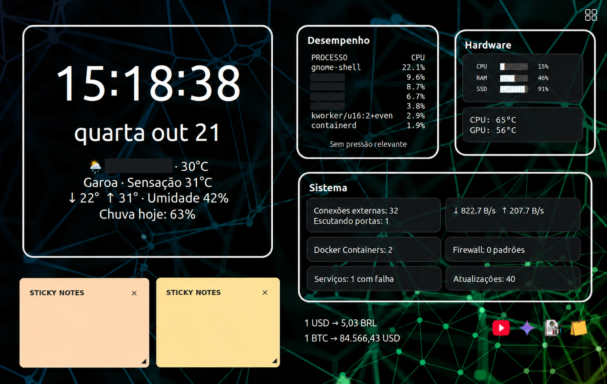
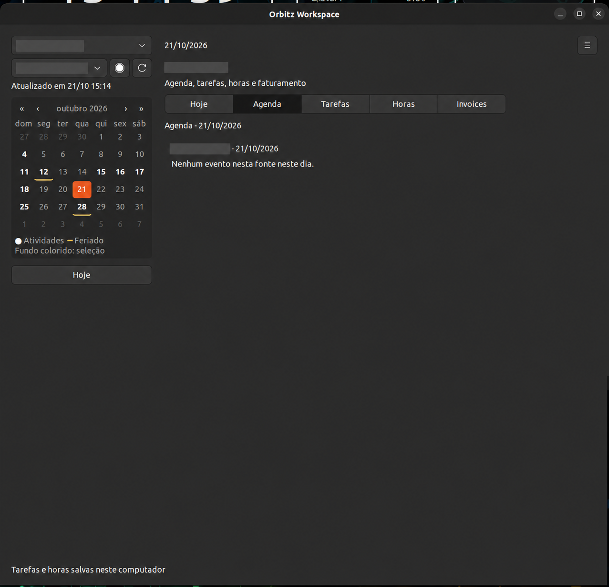
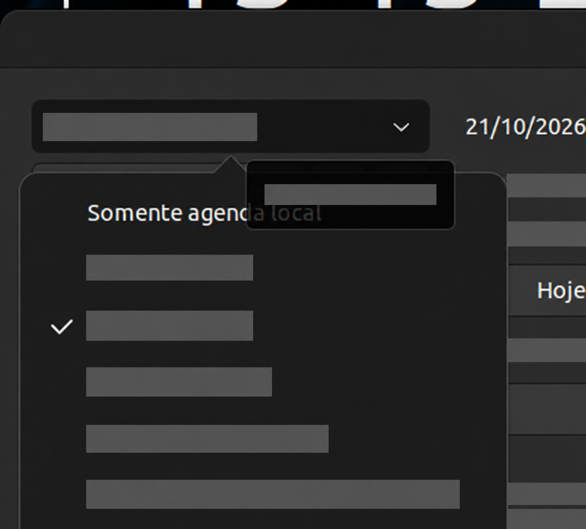
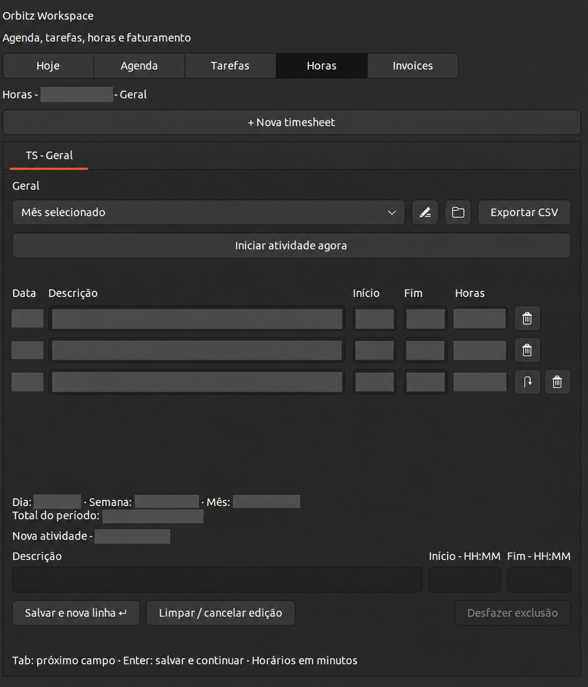
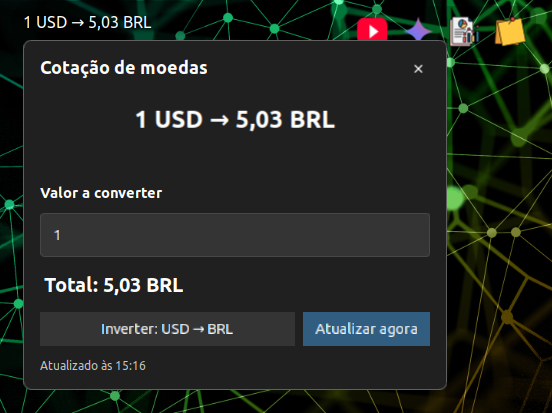
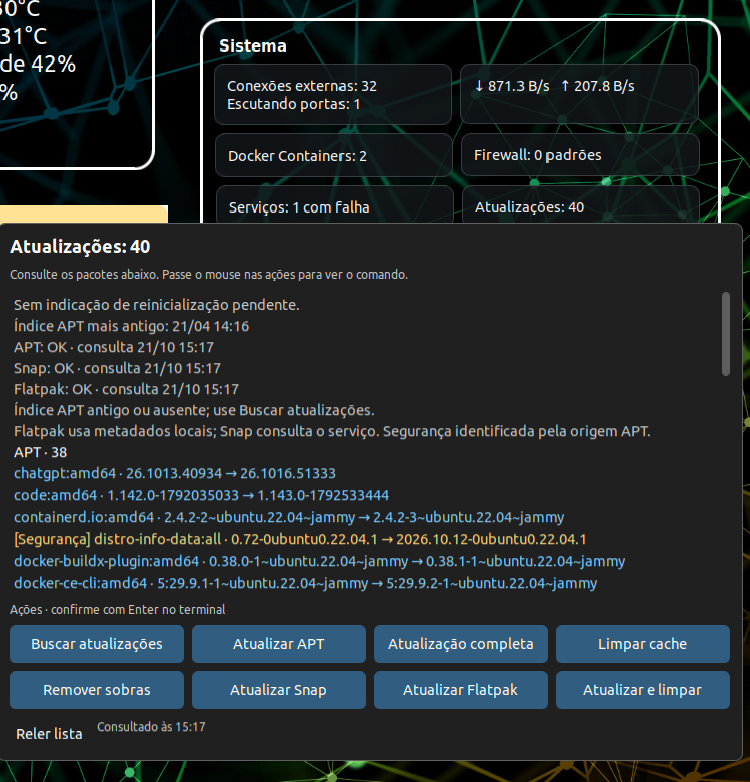
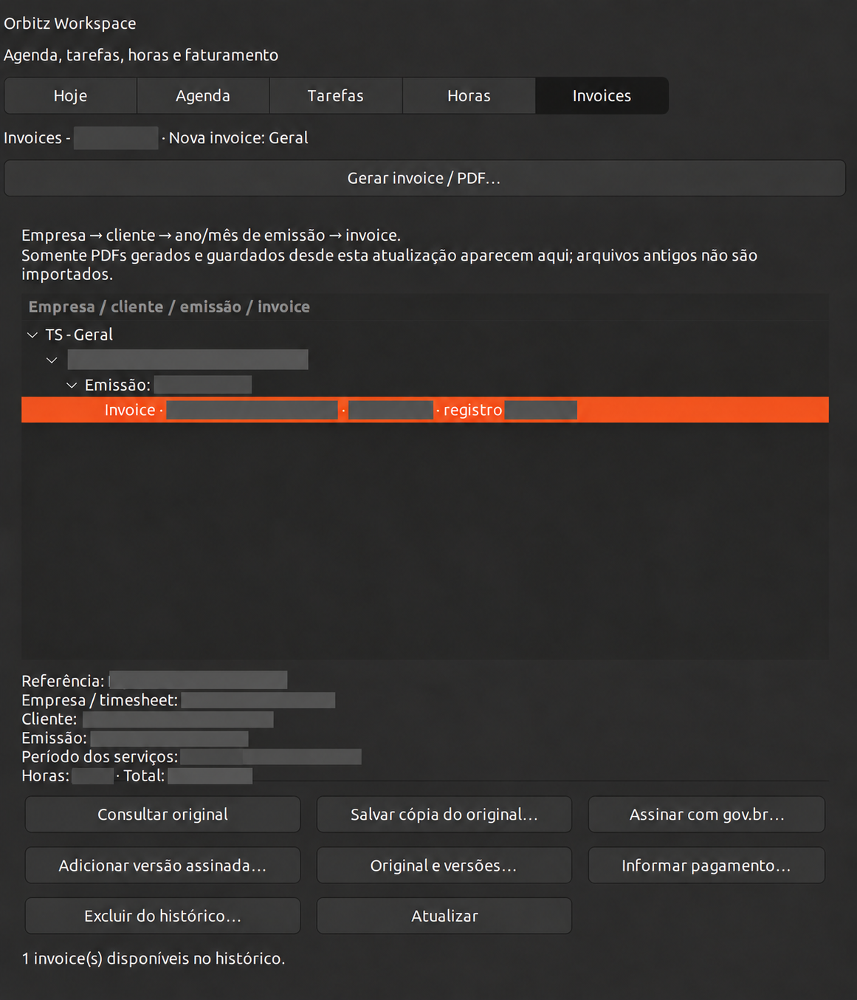

  

<h1 align="center">Orbitz Widgets for GNOME</h1>

<strong>Seu desktop. Seu trabalho. Seu ritmo.</strong>

O Orbitz reúne informações do computador e ferramentas de organização em um desktop GNOME que você adapta à sua rotina. Acompanhe o sistema sem perder de vista seus compromissos, tarefas e horas de trabalho.

A interface está disponível em Português (Brasil) e English (United States); escolha o idioma em Settings.

  

## Um desktop que trabalha com você

Escolha os widgets, organize posições e grupos e ajuste a aparência. Use o controlador na área de trabalho para mostrar ou pausar o conjunto. De um relance, acompanhe relógio, clima e agenda; recursos do computador, como processador, memória, armazenamento e rede; e informações de sistema, como atualizações, serviços e contêineres.

Clique no widget de clima para abrir uma previsão de sete dias em colunas, alternar entre °C e °F e atualizar a previsão manualmente. Para mudar o local, pesquise uma cidade e selecione uma opção apresentada como Cidade · Região · País. A busca usa a [Geocoding API da Open-Meteo](https://open-meteo.com/en/docs/geocoding-api), que retorna até dez correspondências por consulta com dados geográficos do GeoNames; atribuição aparece na interface. A fonte meteorológica é a [Open-Meteo](https://open-meteo.com/). O uso gratuito da previsão requer atribuição e é não comercial; consulte os [termos](https://open-meteo.com/en/terms) para outras modalidades.

O **Currency Converter** reúne conversões fiduciárias e cripto no mesmo widget. No modo Fiat, converte BRL para a moeda escolhida, com duas casas decimais e separadores de milhar, e permite inverter o sentido. No modo Crypto, consulta USD para o ativo selecionado (BTC por padrão) e também permite inverter a conversão. A modal oferece atualização manual e uma calculadora que usa a mesma cotação; para cripto, preserva as casas decimais necessárias para mostrar frações pequenas. As consultas automáticas ocorrem a cada quatro horas. Fiat usa a última referência diária disponível da [Frankfurter](https://frankfurter.dev/), publicada em dias úteis e não em tempo real. Cripto usa os tickers da [CoinPaprika](https://coinpaprika.com/api), cuja atribuição aparece na modal; o catálogo inclui os ativos com preço disponível nessa fonte, não todas as criptomoedas.

O plano gratuito da CoinPaprika é para uso pessoal e exige atribuição. Exibir ou redistribuir os dados para clientes comerciais requer licença compatível; consulte os [planos](https://coinpaprika.com/api/pricing) e os [termos da API](https://coinpaprika.com/terms-api) antes desse uso.

Controles de mídia e lançadores deixam suas ferramentas à mão. Gemini e btop permanecem disponíveis como atalhos; Sticky Notes e YouTube são mini apps independentes, com configurações, traduções e instalações próprias. As informações de hardware variam conforme o computador, os sensores e as permissões disponíveis.

O mini app [Sticky Notes - By Orbitz](https://github.com/orbitzone/orbitz-sticky-notes) é instalado e atualizado separadamente, sem exigir a extensão GNOME. Ele oferece notas com PIN, notas secretas, backups locais e idioma PT/EN nas configurações. Seus dados e preferências ficam separados dos widgets.

O mini app [YouTube Wrapper - By Orbitz](https://github.com/orbitzone/orbitz-youtube-wrapper) busca vídeos, Shorts, transmissões ao vivo, podcasts e comentários. A busca de podcasts acrescenta o termo “podcast” à consulta e pode retornar outros vídeos. A busca e os comentários usam uma chave própria da YouTube Data API; a reprodução continua no player incorporado oficial e segue as regras do YouTube. O idioma PT/EN é selecionado nas configurações do app. Consulte o repositório para pacotes e compatibilidade.

## Capturas de tela

<table>
  <tr>
    <td align="center"> Agenda e calendário</td>
    <td align="center"> Calendários conectados</td>
  </tr>
  <tr>
    <td align="center"> Registro de horas</td>
    <td align="center"> Conversor de moedas</td>
  </tr>
  <tr>
    <td align="center"> Atualizações do sistema</td>
    <td align="center"> Histórico de invoices</td>
  </tr>
</table>

## Do compromisso à entrega

O **Orbitz Workspace** conecta planejamento e registro do trabalho em cinco áreas:

- **Hoje e Agenda:** consulte compromissos, tarefas e lembretes em uma visão organizada. Conecte Google Calendar, iCloud, Calendly ou uma assinatura ICS; o calendário público **Brasil · Datas comemorativas** está disponível sem login.
- **Tarefas:** transforme compromissos em tarefas quando fizer sentido, acompanhe prazos e registre o trabalho concluído.
- **Horas:** organize timesheets por empresa ou projeto, use cronômetros ou lance horas manualmente, acompanhe totais e exporte CSV.
- **Invoices:** prepare faturas de serviços em PDF, em português ou inglês, usando os períodos e as horas da timesheet.

Tarefas e horas são mantidas localmente e continuam sob seu controle ao conectar ou desconectar calendários. Os calendários externos fornecem compromissos; não substituem seus registros de trabalho.

## Seus dados, suas escolhas

Tarefas, horas, perfis de faturamento e histórico de invoices ficam no computador. As credenciais dos calendários são guardadas no cofre de senhas do sistema. Conecte apenas os serviços que quiser usar.

O Workspace permite criar um backup de tarefas, horas, perfis e histórico de faturas. O arquivo não é criptografado por senha; guarde-o em um local privado. Credenciais, calendários externos, configurações dos widgets e Sticky Notes não fazem parte desse backup. As notas têm cópias de segurança próprias. O PIN das Sticky Notes apenas bloqueia a interface: o conteúdo continua sem criptografia no SQLite e nesses backups, portanto quem tiver acesso direto aos arquivos poderá lê-lo.

## Transparência no faturamento

As invoices do Orbitz são documentos de serviços. O aplicativo não emite NFS-e, calcula impostos nem confirma pagamentos em bancos; pagamentos são anotações manuais. O fluxo de assinatura gov.br é assistido: você assina no portal e importa a versão. A conferência criptográfica da assinatura e do documento deve ser feita por você no serviço oficial VALIDAR.

## Comece

O Orbitz é uma extensão para Linux com GNOME Shell. A compatibilidade declarada é **GNOME 42–44**; o ambiente de referência é **Ubuntu 22.04 com GNOME 42.9**. Os recursos dependem das bibliotecas e ferramentas disponíveis na distribuição.

- [Veja a plataforma e os pré-requisitos](stack.md).
- [Conecte calendários](docs/operations/calendar-integrations.md).
- [Atualize uma instalação existente](docs/operations/local-update.md).
- [Migre uma instalação antiga do Desktop Clock/azclock](docs/operations/identity-migration.md).

O projeto ainda não oferece um instalador validado para uma máquina nova. A compatibilidade declarada também não substitui a validação em cada versão do GNOME.

## Comunidade e créditos

O Orbitz é desenvolvido por **Felipe Santiago / orbitzone**. Encontrou um problema ou quer sugerir uma melhoria? [Abra uma conversa no GitHub](https://github.com/orbitzone/orbitz-widgets-for-gnome/issues).

O projeto tem origem no Desktop Clock/azclock, de Andrew Zaech, e preserva as atribuições de seus componentes. Consulte os [créditos e licenças](docs/credits.md) e o [LICENSE](LICENSE).
